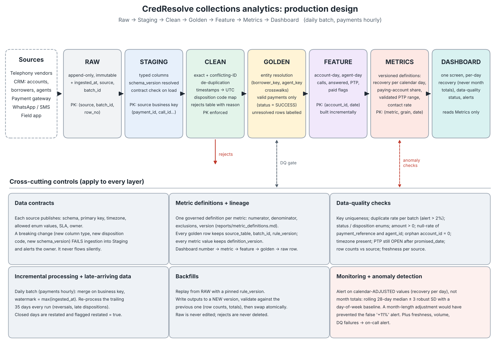
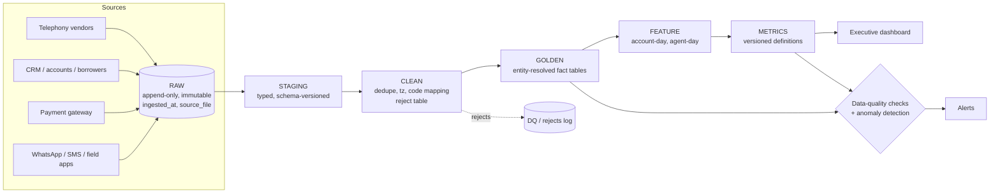

# Production design: Raw → Staging → Clean → Golden → Feature → Metrics → Dashboard

*Visual diagram: `docs/architecture.png` (also `architecture.svg`), regenerated by `python src/make_architecture.py`. The Mermaid source below shows the same flow in text form.*

| Layer | Contents | Primary key | Notes |
|---|---|---|---|
| Raw | files exactly as received + `ingested_at`, `source_system`, `batch_id` | (source, batch_id, row_no) | never updated; enables backfills and lineage |
| Staging | typed columns, schema_version resolved | table business key | one view per schema version |
| Clean | dedupe (exact first, then conflicting IDs with explicit rule), timezone standardised, disposition code mapping table, reject table | payment_id, call_id, ptp_id, account_id | `rejects` keeps row + reason (as in `src/clean.py`) |
| Golden | accounts, payments(valid), calls, ptps, agents, borrowers with resolved entity keys | surrogate keys: `borrower_key`, `agent_key` via crosswalk tables | entity resolution owned by data owners; unresolved rows labelled |
| Feature | account-day (calls, answered, ptp, paid), agent-day | (account_id, date) | built incrementally |
| Metrics | recovery, recovery/day, paying-account share, contact, PTP paid-in-window range, etc. | (metric, grain, date) | definitions in `reports/metric_definitions.md`, versioned |
| Dashboard | one screen: recovery per day, validated PTP kept, contact, DQ status | n/a | |

**Data contracts:** every source publishes schema, key, timezone, allowed enum values and an SLA; a breaking change (new column type, new disposition code, new `schema_version`) fails ingestion into staging and alerts the owner rather than flowing silently.
**Metric definitions:** one governed definition per metric (numerator, denominator, exclusions); the dashboard shows recovery **per day**, never raw month totals.
**Lineage:** each golden row stores `source_table`, `batch_id`, `rule_version`; each metric stores definition version.
**Incremental processing:** daily batch (hourly for payments) merges on business key by `event_at` partition; watermark = max `ingested_at`.
**Late-arriving data:** re-process the trailing 35 days each run (payments reversals, dispositions); metrics for closed days are restated and flagged `restated=true`.
**Backfills:** replay from Raw with a pinned `rule_version`; outputs written to a new version and swapped atomically.
**Data-quality checks (examples):** key uniqueness; duplicate-rate per batch (alert >2%); payment status enum; amount > 0; reference null-rate; orphan account_id = 0; call `agent_id` null-rate; timezone present; `PTP` OPEN past `promised_date`; dispositions on unanswered calls; row-count vs source.
**Monitoring and anomaly detection:** freshness per source; volume per day; metric tests use **calendar-adjusted** values (recovery per day) with a rolling 28-day mean ± 3 robust SD, and a week-day seasonal baseline. A month-length adjustment would have prevented the false "+11%" alert.
